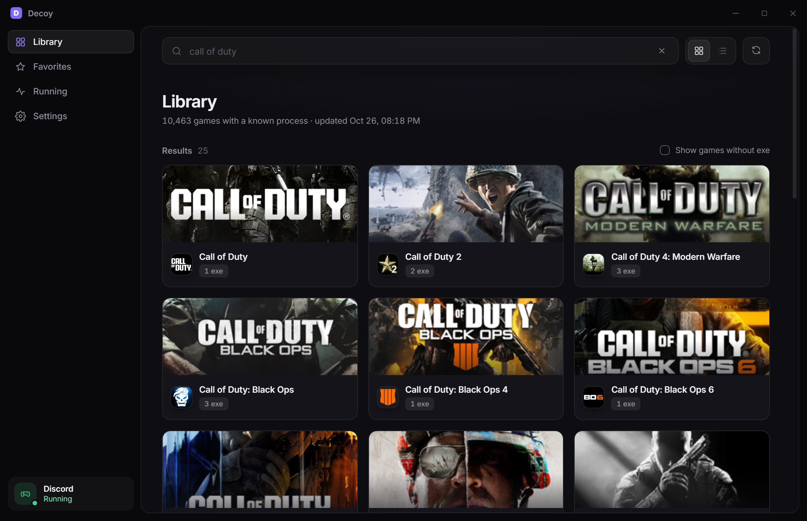
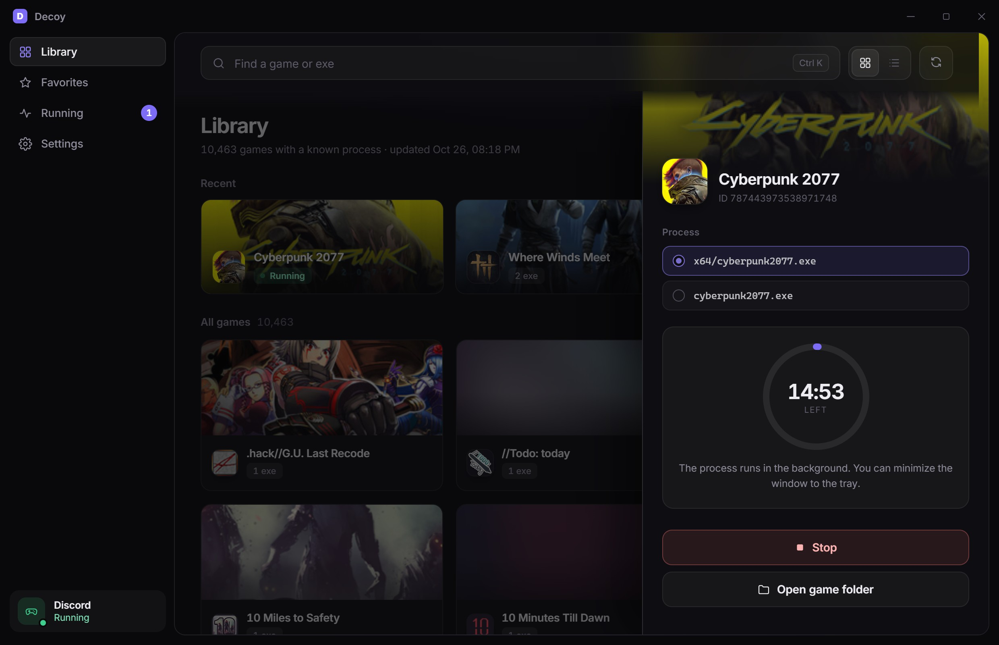
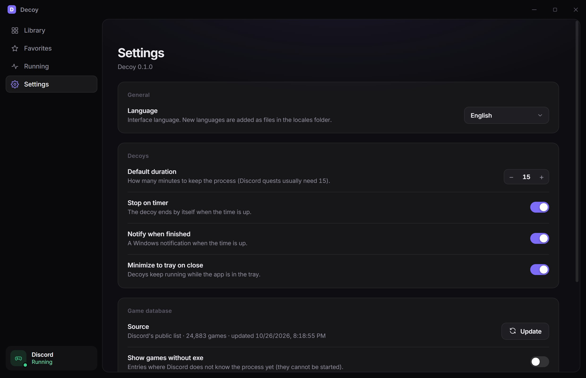

<!-- LANGUAGES:START -->
**Чӑвашла** · [English](../../README.md) · [简体中文](README.zh-CN.md) · [Español](README.es.md) · [हिन्दी](README.hi.md) · [العربية](README.ar.md) · [Português (Brasil)](README.pt-BR.md) · [Русский](README.ru.md) · [日本語](README.ja.md) · [Deutsch](README.de.md) · [Français](README.fr.md)

<details>
<summary>🌐 All languages (178)</summary>

[Аԥсшәа](README.ab.md) · [Адыгабзэ](README.ady.md) · [Afrikaans](README.af.md) · [Shqip](README.sq.md) · [አማርኛ](README.am.md) · [العربية](README.ar.md) · [Aragonés](README.an.md) · [Հայերեն](README.hy.md) · [অসমীয়া](README.as.md) · [Asturianu](README.ast.md) · [Авар мацӏ](README.av.md) · [Azərbaycan](README.az.md) · [বাংলা](README.bn.md) · [Башҡортса](README.ba.md) · [Euskara](README.eu.md) · [Беларуская](README.be.md) · [Bosanski](README.bs.md) · [Português (Brasil)](README.pt-BR.md) · [Brezhoneg](README.br.md) · [Български](README.bg.md) · [Буряад хэлэн](README.bua.md) · [မြန်မာ](README.my.md) · [Català](README.ca.md) · [Binisaya](README.ceb.md) · [کوردی (سۆرانی)](README.ckb.md) · [Нохчийн](README.ce.md) · [简体中文](README.zh-CN.md) · [繁體中文 (香港)](README.zh-HK.md) · [繁體中文 (台灣)](README.zh-TW.md) · **Чӑвашла** · [Kernowek](README.kw.md) · [Corsu](README.co.md) · [Qırımtatar tili](README.crh.md) · [Hrvatski](README.hr.md) · [Čeština](README.cs.md) · [Dansk](README.da.md) · [ދިވެހި](README.dv.md) · [Nederlands](README.nl.md) · [English](../../README.md) · [Pirate English](README.en-pirate.md) · [Эрзянь кель](README.myv.md) · [Esperanto](README.eo.md) · [Eesti](README.et.md) · [Português (Portugal)](README.pt-PT.md) · [Føroyskt](README.fo.md) · [Filipino](README.fil.md) · [Suomi](README.fi.md) · [Français](README.fr.md) · [Furlan](README.fur.md) · [Gagauz dili](README.gag.md) · [Galego](README.gl.md) · [ქართული](README.ka.md) · [Deutsch](README.de.md) · [Ελληνικά](README.el.md) · [Avañe'ẽ](README.gn.md) · [ગુજરાતી](README.gu.md) · [Kreyòl ayisyen](README.ht.md) · [Hausa](README.ha.md) · [ʻŌlelo Hawaiʻi](README.haw.md) · [עברית](README.he.md) · [हिन्दी](README.hi.md) · [Magyar](README.hu.md) · [Íslenska](README.is.md) · [Asụsụ Igbo](README.ig.md) · [Bahasa Indonesia](README.id.md) · [Гӏалгӏай мотт](README.inh.md) · [Interlingua](README.ia.md) · [Gaeilge](README.ga.md) · [Italiano](README.it.md) · [日本語](README.ja.md) · [Basa Jawa](README.jv.md) · [Адыгэбзэ](README.kbd.md) · [Хальмг келн](README.xal.md) · [ಕನ್ನಡ](README.kn.md) · [Qaraqalpaq tili](README.kaa.md) · [Къарачай-малкъар](README.krc.md) · [Karjala](README.krl.md) · [Kaszëbsczi](README.csb.md) · [Қазақша](README.kk.md) · [ខ្មែរ](README.km.md) · [Ikinyarwanda](README.rw.md) · [Коми кыв](README.kv.md) · [한국어](README.ko.md) · [Къумукъ тил](README.kum.md) · [Kurdî (Kurmancî)](README.ku.md) · [Кыргызча](README.ky.md) · [ລາວ](README.lo.md) · [Latina](README.la.md) · [Español (Latinoamérica)](README.es-419.md) · [Latviešu](README.lv.md) · [Лезги чӏал](README.lez.md) · [Ligure](README.lij.md) · [Limburgs](README.li.md) · [Lietuvių](README.lt.md) · [Lumbaart](README.lmo.md) · [Plattdüütsch](README.nds.md) · [Dolnoserbšćina](README.dsb.md) · [Lëtzebuergesch](README.lb.md) · [Македонски](README.mk.md) · [Malagasy](README.mg.md) · [Bahasa Melayu](README.ms.md) · [മലയാളം](README.ml.md) · [Malti](README.mt.md) · [Gaelg](README.gv.md) · [Te Reo Māori](README.mi.md) · [मराठी](README.mr.md) · [Олык марий](README.mhr.md) · [Мокшень кяль](README.mdf.md) · [Монгол](README.mn.md) · [Crnogorski](README.cnr.md) · [Napulitano](README.nap.md) · [नेपाली](README.ne.md) · [Davvisámegiella](README.se.md) · [Norsk](README.no.md) · [Chichewa](README.ny.md) · [Occitan](README.oc.md) · [ଓଡ଼ିଆ](README.or.md) · [Afaan Oromoo](README.om.md) · [Ирон](README.os.md) · [پښتو](README.ps.md) · [فارسی](README.fa.md) · [Polski](README.pl.md) · [ਪੰਜਾਬੀ](README.pa.md) · [Runasimi](README.qu.md) · [Română](README.ro.md) · [Rumantsch](README.rm.md) · [Romani čhib](README.rom.md) · [Русский](README.ru.md) · [Русиньскый](README.rue.md) · [Gagana fa'a Samoa](README.sm.md) · [Sardu](README.sc.md) · [Scots](README.sco.md) · [Gàidhlig](README.gd.md) · [Српски](README.sr.md) · [chiShona](README.sn.md) · [Sicilianu](README.scn.md) · [Ślůnski](README.szl.md) · [سنڌي](README.sd.md) · [සිංහල](README.si.md) · [Slovenčina](README.sk.md) · [Slovenščina](README.sl.md) · [Soomaali](README.so.md) · [Алтай тил](README.alt.md) · [Sesotho](README.st.md) · [Español](README.es.md) · [Basa Sunda](README.su.md) · [Kiswahili](README.sw.md) · [Svenska](README.sv.md) · [Schwyzerdütsch](README.gsw.md) · [Тоҷикӣ](README.tg.md) · [தமிழ்](README.ta.md) · [Татарча](README.tt.md) · [తెలుగు](README.te.md) · [ไทย](README.th.md) · [ትግርኛ](README.ti.md) · [toki pona](README.tok.md) · [Türkçe](README.tr.md) · [Türkmençe](README.tk.md) · [Тыва дыл](README.tyv.md) · [Удмурт кыл](README.udm.md) · [Українська](README.uk.md) · [Hornjoserbšćina](README.hsb.md) · [اردو](README.ur.md) · [ئۇيغۇرچە](README.ug.md) · [O‘zbekcha](README.uz.md) · [Vèneto](README.vec.md) · [Tiếng Việt](README.vi.md) · [Walon](README.wa.md) · [Cymraeg](README.cy.md) · [West-Vlams](README.vls.md) · [Frysk](README.fy.md) · [isiXhosa](README.xh.md) · [Саха тыла](README.sah.md) · [ייִדיש](README.yi.md) · [Yorùbá](README.yo.md) · [Zeêuws](README.zea.md) · [isiZulu](README.zu.md) · [Хакас тілі](README.kjh.md)

</details>
<!-- LANGUAGES:END -->

<div align="center">


# Decoy

**Discord вӑйӑ пырать тесе шухӑшлатӑр тесе ятарласа ӗҫлеттерекен пӗчӗк яру-процессем.**


</div>

Decoy вӑйӑн ӗҫлекен файл ячӗпе чӳречеллӗ сиенсӗр яру-процесс ӗҫлеттерет, ҫавӑнпа та Discord вӑйӑ тупас системи сире ҫак вӑййа выляма пуҫланӑ пек кӑтартать. Чӑн вӑййа лартма та, пуҫлама та кирлӗ мар, ҫавӑнпа диск ҫинче нимӗнлӗх ахаль вырӑн йышӑнмасть.

Вӑл **Discord тупма пултаракан кашни вӑййа** (25 000 яхӑн ҫырнӑ вӑйӑ) пӗлет, мӗншӗн тесен Discord хӑйӗн уҫӑ списокне вулать тата ӑна хӑй тӗллӗн ҫӗнетсе тӑрать.

> [!WARNING]
> Вӑйӑ процесне улталани Discord Йӗркисене пӑсма пултарать, Decoy-па эсир **хӑвӑр яваплӑхпа** усӑ куратӑр.
> Ҫак проект Discord Inc. компанийӗпе ҫыхӑнман, унпа ҫирӗплетмен тата пулӑшса пынӑ мар. [Яваплӑхран хӑтарни](#яваплӑхран-хӑтарни) пӑхӑр.

## Малти майсем

- **Discord палӑртма пултаракан пӗтӗм япала.** Вӑйӑсен списокне Discord-ӑн уҫӑ серверӗнчен тиесе илеҫҫӗ, локаллӗ упараҫҫӗ тата кашни кун ҫӗнетеҫҫӗ. Ҫӗнӗ вӑйӑсемпе ҫӗнӗ ӗҫлекен файлсем хӑйсемех тухса пыраҫҫӗ.
- **Хӑвӑрт шырав.** Пин-пин вӑйӑ хушшинче вӑйӑ ячӗпе е ӗҫлекен файл ячӗпе тӳрех шырасси, плиткӑсемпе е компактлӑ списокпа кӑтартасси, юратнисем тата «Юлашкисем» йӗрӗ.
- **Пӗр пуснипех.** Вӑййа суйлӑр, ӗҫлекен файла суйлӑр (пӗрне-пӗр миҫе пулсан), миҫе минут тытмаллине палӑртӑр та «Decoy яруне пуҫла» пусӑр. Вӑхӑт шутлав ҫаврипе пӗлтерӳ вӑхӑт тулнине хыпарлӗҫ.
- **Нимӗн те хӑвармасть.** Decoy вӑл ӗҫленӗ чухне кӑна пулать: пӗчӗк exe пуҫланӑ чухне туса хураҫҫӗ, чарсан — тӳрех катертсе яраҫҫӗ. Программӑран тухсан пӗтӗм япала чарӑнать, программӑра йӑнӑш сиксе тухсан юлнӑ файлсене вара тепӗр хут уҫнӑ чухне тасатаҫҫӗ.
- **Шӑп ӗҫлет.** Системӑри трейра пурӑнать, decoyсем валли уйрӑм чӳречесем е ӗҫ панелӗ ҫинче кнопкӑсем ҫук.
- **Уҫӑ куҫарусем.** Интерфейс ахаль JSON-файлсем ҫинче ӗҫлет, ҫавӑнпа ҫӗнӗ чӗлхе хушасси — вӑл пӗр файл кӑна. Англи тата вырӑс чӗлхисем хатӗрех кӗртнӗ.
- **Харпӑрлӑх.** Аккаунтсӑр, Discord токенсӑр, телеметрисӗр. [Харпӑрлӑх](#харпӑрлӑх) пӑхӑр.

## Скриншотсем

<table>
  <tr>
    <td width="50%"><br /><sub><b>Хӑвӑрт шырав</b> Discord тупма пултаракан пӗтӗм вӑйӑ тӑрӑх</sub></td>
    <td width="50%"><br /><sub><b>Пӗр пуснипех.</b> Вӑхӑт шутлавӗ decoy ӗҫлеме миҫе юлнине кӑтартать</sub></td>
  </tr>
  <tr>
    <td width="50%"><br /><sub><b>Юратнисем</b> чи час-часах усӑ куракан вӑйӑсем валли</sub></td>
    <td width="50%"><br /><sub><b>Ӗҫлӗхсем</b> чӗлхе суйлавӗпе тата малтанхи вӑхӑтпа</sub></td>
  </tr>
</table>

## Ку мӗнле ӗҫлет

1. Discord эсир вӑйӑ вылянине сирӗн компьютерти ӗҫлекен процессене тӗрӗслесе тата вӗсен ӗҫлекен файл ячӗсене халӑх списокӗпе (`/api/v9/applications/detectable`) танлаштарса пӗлет.
2. Decoy ҫав списка тиесе илет те, эсир суйланӑ вӑйӑ валли, списокран илнӗ файл ячӗпе пӗчӗк яру-программӑна (120 КБ яхӑн, Rust чӗлхипе ҫырнӑ тата Decoy ӑшне кӗртнӗ) вӑхӑтлӑх папкана копилет, тӗслӗхрен `.../cod26-cod.exe`.
3. Ку яру программӑ экран тулашӗнче аякра вырнаҫнӑ пӗр чӳрече кӑна туса хурать, ҫавӑнпа эсир ӑна курмастӑр. Discord чӳречеллӗ процессене кӑна тупать, ҫавӑнпа чӳречесӗр процессене шута илмест.
4. 15 ҫеккунт хушшинче Discord ҫак вӑййа сирӗн хальхи ӗҫ пек кӑтартма пуҫлать.
5. Таймер тулсан е чару кнопкӑне пуссан, Decoy процесса чарать тата файла тӗпрен тасатать. Windows job object яру-процессем Decoy-па пӗрле чарӑннине тивӗҫтерет, программӑ йӑнӑшпа хупӑнсан та.

## Лартни

[Кӑларӑмсен страницинчен](../../../../releases) суйлӑр:

| Тиесе илмелли | Валли |
|---|---|
| `Decoy_x.y.z_x64-setup.exe` | **Инсталлятор.** Пӗр усӑ куракан валли, администратор прависем кирлӗ мар, «Пуҫла» менюне пункт тата деинсталлятор хушать. |
| `Decoy_x.y.z_x64-portable.zip` | **Портативлӑ верси.** Кирек ӑҫта та салатӑр та `decoy.exe` пуҫлӑр. Пӗтӗм даннӑйсем ҫумӗнчи `data` папкине ҫырӑнаҫҫӗ, профиль ӑшне нимӗн те ҫырӑнмасть. Кӑларса пӑрахма папкана тӗпрен катертӗр. |

Тиенӗ файлӑн тӗрӗслӗхне `SHA256SUMS.txt` урлӑ тӗрӗслӗр (PowerShell хушшинче: `Get-FileHash <file>`).

Windows SmartScreen паллӑ мар автор ҫинчен асӑрхаттарма пултарать, мӗншӗн тесен сборкӑсен цифра алӑ пусӑвӗ ҫук; эсир сборкӑна ӗненетӗр пулсан, *Подробнее → Выполнить в любом случае* суйлӑр.

Йӗркесем: Windows 10 е 11 (64-бит) тата WebView2 среду (Windows 11-ре тата юлашки Windows 10 ҫӗнетӗвӗсенче пур).

## Усӑ курни

1. **Библиотекӑна** уҫӑр та вӑйӑ шырӑр, е программӑн кирек хӑш вырӑнӗнче `Ctrl` + `K` пусӑр.
2. Вӑйӑ ҫинче пусӑр. Сылтӑм енчи панельте процесса тата миҫе минут тытмаллине суйлӑр (Discord яланхилле 15 минут ыйтать).
3. **Decoy яруне пуҫла** ҫинче пусӑр. Темиҫе ҫеккунтран Discord вӑййа кӑтартӗ.
4. Ӑна **Ӗҫлекенсем** пайӗнче сӑнӑр, пӗрне е пурне те чарма пулать, е Decoy-а трейра ӗҫлеме хӑварӑр.

Discord списокӗнче халлӗхе exe ҫук вӑйӑсем курӑнмаҫҫӗ (вӗсене тупма май ҫук). Вӗсене курма *exe ҫук вӑйӑсене кӑтарт* ҫыхӑнтартӑр; список кашни кун ҫӗнелет, ҫавӑнпа Discord процесс хушсанах вӗсем хатӗр пулӗҫ.

### Команда йӗрӗ

```
decoy.exe --launch "<executable path from the Discord list>" [minutes]
```

Тӳрех decoy пуҫлать, тӗслӗхрен: `decoy.exe --launch "robloxplayerbeta.exe" 15`.

## Исходниксенчен пухса хатӗрлени

Кирлӗ япаласем: [Node.js](https://nodejs.org) 20+, стабиллӗ [Rust](https://rustup.rs) хатӗрӗсен пуххи (MSVC target) Visual Studio C++ хатӗрӗсемпе, тата WebView2 runtime.

```bash
git clone https://github.com/leon03131/Decoy.git
cd Decoy
npm install

npm run tauri dev      # run in development mode with hot reload
npm run tauri build    # produce the installer in src-tauri/target/release/bundle/nsis
```

Усӑллӑ тӗрӗслевсем:

```bash
npm run check-locales  # validate every translation file against ru.json
npx tsc --noEmit       # type-check the frontend
cargo check --manifest-path src-tauri/Cargo.toml
```

Асӑрхаттарусем: decoy ӗҫлекен файлне `src-tauri/build.rs` скрипт ахаль `rustc` пулӑшнипе `src-tauri/stub/stub.rs` файлран пухса хатӗрлет тата унтан программӑна кӗртет. Фронтенд браузерта ӗҫленӗ чухне (`npm run dev`) пӗчӗк мок-сервер (`src/mock.ts`) ӗҫлет, ку интерфейспа ӗҫлеме питӗ меллӗ.

## Куҫарусем

Интерфейс ҫырӑвӗсем [`src/locales`](../../src/locales) папкире уранаҫҫӗ, кашни чӗлхе валли пӗр JSON файл (`en.json`, `ru.json`, ...).
Ҫӗнӗ чӗлхе хушасси — вӑл код улшӑнӑвӗсемсӗр ҫӗнӗ файл кӗртесси кӑна. Файл формине, куҫару валли хатӗр промпта тата тӗрӗслев скриптне [docs/TRANSLATING.md](../TRANSLATING.md) палӑртнӑ. Ҫак README куҫарӑвӗсем `docs/i18n/README.<code>.md` папкана каяҫҫӗ.

## Проект тытӑмӗ

```
src/                    React + TypeScript frontend
  components/           Library, detail panel, settings, ...
  locales/              translation files (one JSON per language)
  i18n-core.ts          language loading and lookup
  store.ts              application state (zustand)
src-tauri/              Rust backend (Tauri 2)
  src/lib.rs            game database, decoy processes, tray
  stub/stub.rs          the stand-in program that gets embedded
scripts/                helper scripts (locale validation)
docs/                   translating guide, screenshots
```

## Харпӑрлӑх

- Decoy сетьпе Discord халӑх списокне тиесе илме кӑна усӑ курать (чи пӗрремӗш пуҫланӑ чухне, кайран кунне пӗрререн час мар е ҫӗнетӳ пуснӑ чухне) тата вӑйӑ паллисемпе хуплашкисене кӑтартма Discord халӑх CDN-ӗнчен илет.
- Вӑл сирӗн Discord токенне е аккаунт пӗлӗмӗсене вуламасть, упрамасть тата ярса памасть, ҫавӑн пекех Discord клиенчӗпе ҫыхӑнмасть.
- Ӗҫлӗхсем (юратнисем, чӗлхе, вӑхӑтсем) программӑн WebView управӗнче локаллӗ упранаҫҫӗ; вӑйӑсен кэшӗ тата вӑхӑтлӑх decoy файлӗсем `%LOCALAPPDATA%\app.decoy.desktop` папкире упранаҫҫӗ.
- Аналитика ҫук, сбойсен отчетӗсем ҫук, аккаунтсем ҫук.

## Паллӑ чарӑнусем

- Discord вӑйӑ тупас майӗсене кирек хӑш вӑхӑтра та улӑштарма пултарать. Decoy тупӑнма пӑрахсан, тархасшӑн, issue уҫӑр.
- Хӑш-пӗр вӑйӑсем валли ӗҫлекен процесс кӑна мар (тӗслӗхрен, платформа ӑшӗнче ятарлӑ режимре пулмалла). Decoy процеса кӑна ултавлӑ туса кӑтартать.
- Discord списокӗнче ӗҫлекен файлсӑр ҫырнисен палӑртӑвӗ пулма пултараймасть.
- Хӳтлӗх программисем хӑш чухне астӑвӑмра нимӗн тумасӑр ларакан пӗчӗк алӑ пусман файлсене сисме пултараҫҫӗ. Decoy уҫӑ кодлӑ тата вӑл `src-tauri/stub/stub.rs` файлран пухӑнать; эсир ӑна хӑвӑрах пухма пултаратӑр.

## Проекта пулӑшасси

Йӑнӑшсен пӗлтерӗвӗсем, шухӑшсемпе сӗнӳсем тата куҫарусем йышӑнатпӑр. Тархасшӑн, малтан [CONTRIBUTING.md](../../CONTRIBUTING.md) вуласа тухӑр.

## Яваплӑхран хӑтарни

Decoy харпӑр хӑй, вӗренӳ тата паллашу тӗллевӗсем валли «мӗнле пур, ҫавӑн пек» парать. Ӗҫлекен вӑййа ултавлани Discord е вӑйӑ кӑлараканӗн Йӗркисене пӑсма пултарать тата сирӗн аккаунт ҫине ҫирӗп витӗм кӳме пултарать. Ӑна усӑ курнӑшӑн эсир хӑвӑр кӑна яваплӑ. «Discord» тата пӗтӗм вӑйӑ ячӗсемпе логотипӗсем хӑйсен хуҫисен товар паллисем пулса тӑраҫҫӗ тата кунта программӑна палӑртма кӑна усӑ курӑнаҫҫӗ.

## Лицензи

[MIT](../../LICENSE)
